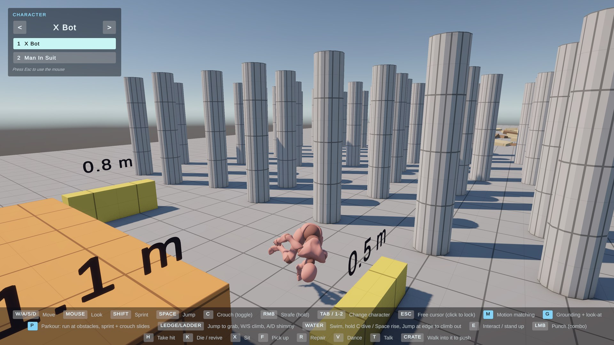

# 3D Character Controller

A third-person character controller for Unity 6 (URP) with motion matching locomotion, parkour, climbing and swimming.

## Features

- Motion matching locomotion (MxM) with walk, run, sprint and strafe, foot locking and stride matched playback
- Parkour: hurdles, medium and high climbs, drops and rolls, slides under low roofs
- Ledge hanging, shimmying and ladders
- Swimming and diving with breath, underwater camera and water effects
- Smart third-person camera that keeps the whole player in view
- Body contact solving and hand IK so hands meet real edges and limbs stay out of obstacles
- MotionAudit dev tool that runs scripted scenarios and reports unrealistic motion

## Controls

| Input | Action |
|---|---|
| W/A/S/D, Mouse | Move, look |
| Shift | Sprint |
| Space | Jump |
| C | Crouch (toggle) |
| Right mouse | Strafe (hold) |
| Tab / 1-2 | Change character |
| P | Toggle parkour (run at obstacles, sprint + crouch to slide) |
| M / G | Toggle motion matching / grounding and look-at |

## Getting started

Open the project in Unity 6000.4 and load `Assets/Scenes/OpenWorld.unity`.
